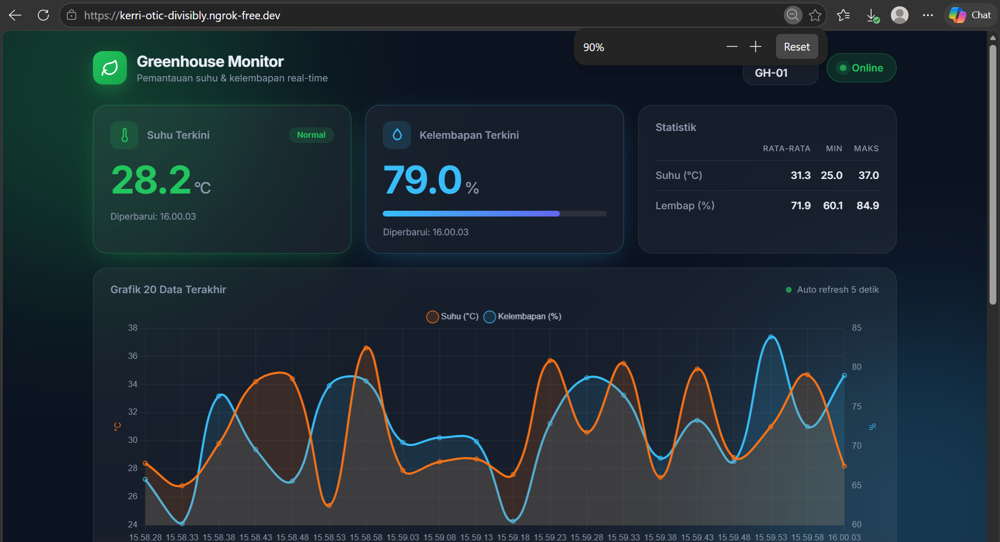
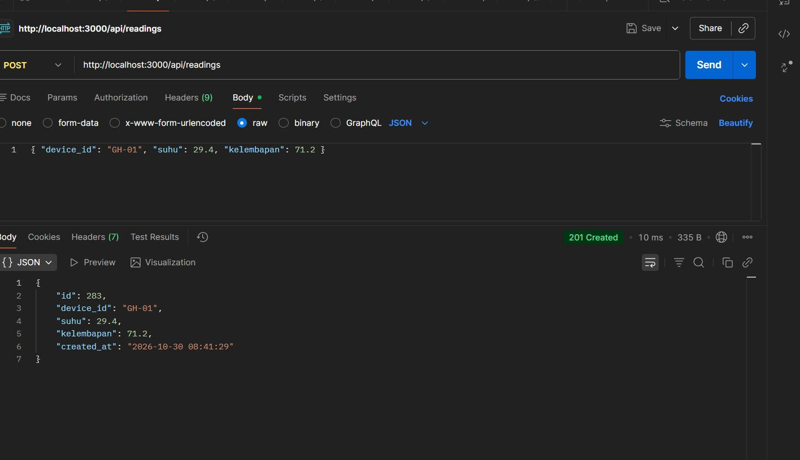
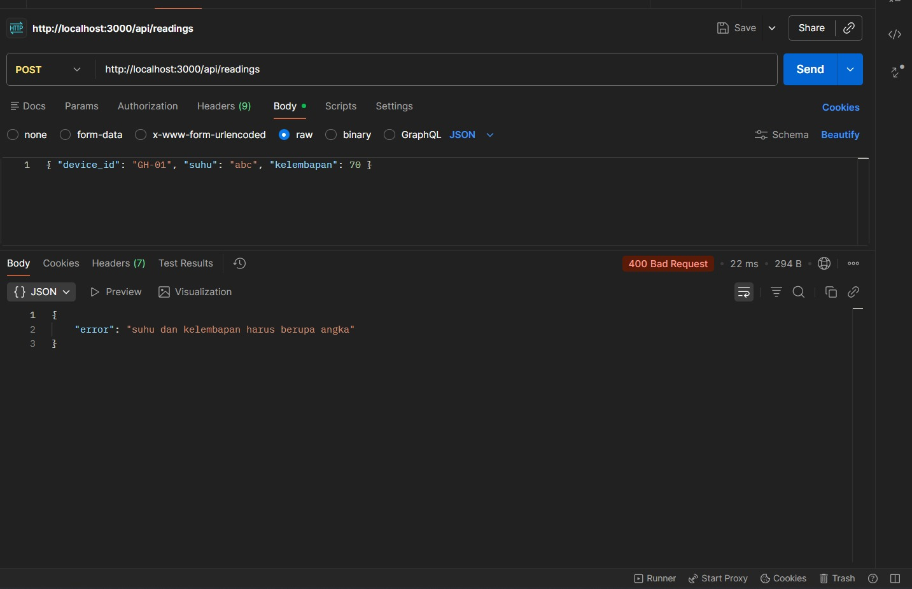

# IoT Monitoring Greenhouse

Aplikasi web monitoring suhu dan kelembapan Greenhouse. Perangkat atau simulator mengirim data sensor setiap 5 detik melalui HTTP POST ke backend Express. Backend memvalidasi dan menyimpan data ke SQLite, lalu dashboard web mengambil data lewat REST API dan memperbaruinya otomatis setiap 5 detik.

## Identitas

- Mata kuliah: Workshop Sistem Tertanam
- Kelas: TIF D 2024

| Nama | NIM | Peran |
| Deni Tri Prayoga | E41241505 | Ketua |
| Agha Purwa Nugraha | E41241405 | Anggota 1 |
| Iqbal Kamali Alpan | E41241525 | Anggota 2 |
| Astriyanti Prima Indah Prawesti | E41241424 | Anggota 3 |

## Teknologi

- HTML, CSS, JavaScript (fetch + Chart.js via CDN)
- Node.js + Express
- SQLite (better-sqlite3)
- Git / GitHub

## Cara Menjalankan

Prasyarat: Node.js LTS, npm, dan Git.

1. Clone repository dan masuk ke foldernya:
   ```bash
   git clone https://github.com/Denitriii/sistemMonitoringSuhu.git
   cd iot-monitoring-E41241505
   ```
2. Pasang dependensi:
   ```bash
   npm install
   ```
3. Terminal 1, jalankan server:
   ```bash
   node server.js
   ```
4. Terminal 2, jalankan simulator:
   ```bash
   node simulator.js
   ```
5. Buka dashboard di browser: http://localhost:3000


## Endpoint API

| Method | Endpoint | Fungsi | Respons sukses |
|---|---|---|---|
| POST | `/api/readings` | Menerima data sensor dari perangkat | 201 + data tersimpan |
| GET | `/api/readings/latest` | Data terbaru untuk kartu nilai | 200 + objek JSON |
| GET | `/api/readings?limit=20` | Riwayat N data terakhir untuk grafik dan tabel | 200 + array JSON |
| GET | `/api/stats` | Rata-rata, minimum, maksimum suhu dan kelembapan | 200 + objek JSON |

### Contoh payload POST

```json
{ "device_id": "GH-01", "suhu": 29.4, "kelembapan": 71.2 }
```

### Validasi

POST ditolak dengan status 400 dan pesan error JSON jika:

- device_id bukan teks atau kosong.
- suhu atau kelembapan bukan angka.
- suhu di luar rentang -40 sampai 80 °C.
- kelembapan di luar rentang 0 sampai 100 %.

Jika device_id tidak dikirim, sistem menggunakan nilai
default GH-01.

Contoh respons gagal:

```json
{ "error": "suhu harus berada di antara -40 dan 80 derajat Celsiu" }
```

## Struktur Tabel `readings`

| Kolom | Tipe | Keterangan |
|---|---|---|
| id | INTEGER | Primary key, autoincrement |
| device_id | TEXT | Kode perangkat |
| suhu | REAL | Suhu dalam °C |
| kelembapan | REAL | Kelembapan relatif dalam % |
| created_at | TEXT | default CURRENT_TIMESTAMP |

## Fitur Dashboard

- Dua kartu nilai: suhu dan kelembapan terkini beserta waktu pembaruan terakhir
- Kartu suhu berubah merah (status "Panas") jika suhu > 35 °C, hijau (status "Normal") jika normal
- Kartu statistik: rata-rata, minimum, dan maksimum suhu serta kelembapan
- Grafik garis (Chart.js) untuk 20 data terakhir suhu dan kelembapan
- Tabel riwayat 10 data terakhir, dengan suhu > 35 °C ditandai merah
- Pembaruan otomatis setiap 5 detik tanpa reload halaman
- Indikator status perangkat: "Online" jika data terakhir < 30 detik, selain itu "Offline"

## Struktur Folder

```
iot-monitoring-E41241505/
├── public/
│   ├── index.html
│   ├── style.css
│   └── app.js
├── screenshots/
├── server.js
├── db.js
├── simulator.js
├── package.json
├── .gitignore
└── README.md
```

## Pengujian

Alur yang diuji: simulator → API → database → dashboard.

- [x] Simulator mengirim data setiap 5 detik dan console menampilkan status 201
- [x] Kartu suhu dan kelembapan berubah otomatis
- [x] Kartu suhu merah saat suhu > 35 °C
- [x] Status perangkat Online, berubah Offline setelah simulator dimatikan lebih dari 30 detik
- [x] Grafik menampilkan 20 data dan tabel menampilkan 10 data
- [x] POST dengan data tidak valid dibalas 400
- [ ] Data tetap ada setelah server di-restart

### Dashboard


### Uji endpoint POST


### Uji endpoint POST TIDAK VALID
 

## Pembagian Tugas

| NIM | Tugas |
| E41241505 | Setup proyek, database, dan REST API |
| E41241525 | Simulator dan pengujian endpoint |
| E41241405 | Dashboard (HTML, CSS, JavaScript, Chart.js) |
| E41241424 | README, dokumentasi, dan screenshot |
| ........ | Git/GitHub dan pengumpulan |
